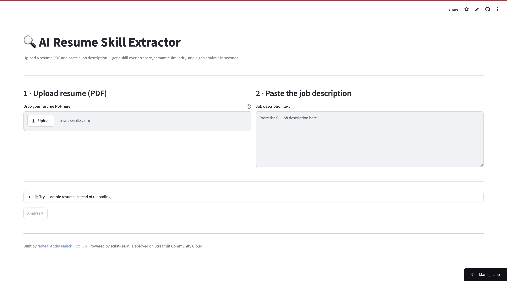

# AI Resume Skill Extractor

[](https://github.com/Nawfal-AI/AI-Resume-Skill-Extractor/actions)
[](https://nawfal-ai-ai-resume-skill-extractor.streamlit.app)

**Live demo -- https://nawfal-ai-ai-resume-skill-extractor.streamlit.app**

> Note: the live demo is hosted on Streamlit Community Cloud's free tier and may take 30-60 seconds to wake up after a period of inactivity. If you see an access error on first load, wait a moment and refresh.

An NLP tool that extracts technical skills from a PDF resume, compares them against a job description, and surfaces a gap analysis -- deployed as a live web application on Streamlit Community Cloud with CI via GitHub Actions.

---

## Dashboard



Upload a resume PDF and paste any job description. The tool produces three outputs in seconds:

- **Skill keyword overlap** -- what percentage of the skills mentioned in the job description are present in the resume, broken down by category (programming languages, ML frameworks, databases, cloud platforms, etc.)
- **Semantic similarity** -- a TF-IDF cosine similarity score between the full resume text and the full job description, capturing vocabulary overlap beyond exact skill matches
- **Gap analysis** -- a list of skills the job description requires that the resume does not mention

Results are displayed in a dashboard with a bar chart of skills by category and a CSV export. Sample resumes are included to try without uploading anything.

---

## How it works

```
Resume PDF
    |
    v
pdfplumber  --  raw text extraction
    |
    v
ResumeSkillExtractor
    |-- regex matching against skills_db.json taxonomy
    +-- spaCy noun-chunk and entity matching (optional, falls back to regex-only)
    |
    v
Categorized skill dict  {programming: [...], ml_frameworks: [...], ...}
    |
    v
matcher.py
    |-- keyword set intersection with JD skills  -->  overlap %
    +-- TF-IDF cosine similarity vs. full JD text  -->  semantic similarity %
    |
    v
MatchResult dataclass  -->  Streamlit dashboard
```

The skill taxonomy lives in `skills_db.json` -- an editable JSON file mapping category names to skill lists, covering 60+ skills across six categories. Updating the taxonomy requires no code changes.

spaCy (`en_core_web_sm`) is used as an optional enhancement for noun-chunk and named-entity extraction on top of regex matching. If spaCy is not installed, the extractor falls back to regex-only mode automatically, which is how the cloud deployment runs.

---

## Project structure

```
AI-Resume-Skill-Extractor/
├── src/resume_skill_extractor/     # installable Python package
│   ├── extractor.py                # PDF -> text -> categorized skills
│   ├── matcher.py                  # resume vs. job description comparison
│   ├── logging_config.py           # structured logging setup
│   └── skills_db.json              # editable skill taxonomy (60+ skills, 6 categories)
├── tests/
│   ├── test_extractor.py           # unit tests: regex, word-boundary edge cases, categorization
│   └── test_matcher.py             # unit tests: overlap scoring, gap detection
├── sample_resumes/                 # two real-format PDFs included for testing
├── docs/
│   └── demo-screenshot.png         # dashboard screenshot
├── legacy/
│   └── ai-resume-skill-extractor.ipynb  # original Kaggle notebook
├── .github/workflows/ci.yml        # GitHub Actions: install, test on every push
├── .streamlit/config.toml          # Streamlit theme and server config
├── app.py                          # Streamlit dashboard entrypoint
├── pyproject.toml                  # packaging, dependencies, optional extras
└── Dockerfile                      # local containerized deployment
```

---

## Engineering decisions

This project started as a Kaggle notebook. The table below records what was deliberately changed and why.

| Original notebook | This version | Reason |
|---|---|---|
| Hardcoded `/kaggle/input` paths | Accepts any `str` or `Path` | Portability |
| `print()` for all output | Structured logging via `logging_config.py` | Callers (dashboard, tests) can capture output instead of it going to stdout |
| Silent `try/except` returning empty results | Raises `PDFExtractionError` | A broken PDF must not silently appear as "zero skills found" |
| Skill list hardcoded inside a method | External `skills_db.json` | Editable without touching code; test fixtures can inject a smaller taxonomy |
| No job description matching | `matcher.py` with TF-IDF cosine similarity | Turned a list of skills into an actionable fit score |
| No tests | `tests/` with pytest, run in CI | Regression safety when editing the taxonomy or extraction logic |
| No packaging | `pyproject.toml` with optional extras (`[dev]`, `[dashboard]`) | Installable as a library; CI installs exactly the same way a user would |
| No deployment | Docker + Streamlit Community Cloud (live URL) | Demonstrates the full path from code to running application |

---

## Tech stack

| Layer | Technology |
|---|---|
| NLP extraction | spaCy `en_core_web_sm` + regex fallback |
| Semantic matching | scikit-learn TF-IDF cosine similarity |
| PDF parsing | pdfplumber |
| Dashboard | Streamlit |
| Cloud deployment | Streamlit Community Cloud (continuous deployment on push to main) |
| Containerization | Docker |
| Testing and CI | pytest + GitHub Actions |
| Packaging | pyproject.toml (src layout, installable with pip) |

---

## Running locally

```bash
git clone https://github.com/Nawfal-AI/AI-Resume-Skill-Extractor.git
cd AI-Resume-Skill-Extractor
pip install -e ".[dashboard]"
python -m spacy download en_core_web_sm   # optional -- falls back to regex-only without it
streamlit run app.py
# open http://localhost:8501
```

With Docker:

```bash
docker build -t resume-skill-extractor .
docker run -p 8501:8501 resume-skill-extractor
```

---

## Running the tests

```bash
pip install -e ".[dev]"
pytest --cov=resume_skill_extractor
```

Tests cover regex extraction, word-boundary edge cases (the skill "R" must not match inside "product"), correct categorization of extracted skills, overlap scoring, and gap detection. CI runs the full suite on every push to main via GitHub Actions.

---

## Extending the skill taxonomy

Open `src/resume_skill_extractor/skills_db.json` and add skills to any existing category, or add a new category key. No code changes are needed. The extractor and matcher pick up the updated file at runtime.

---

## License

MIT
